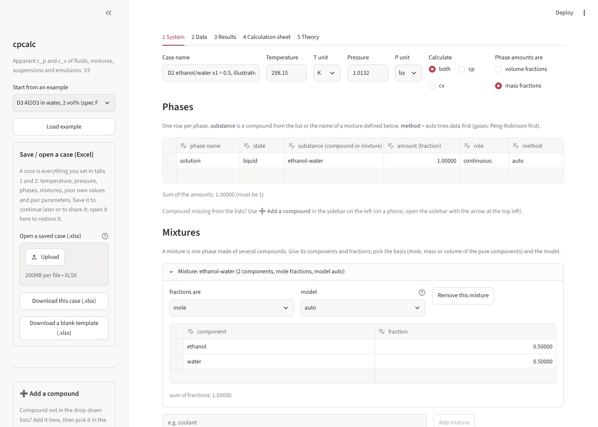
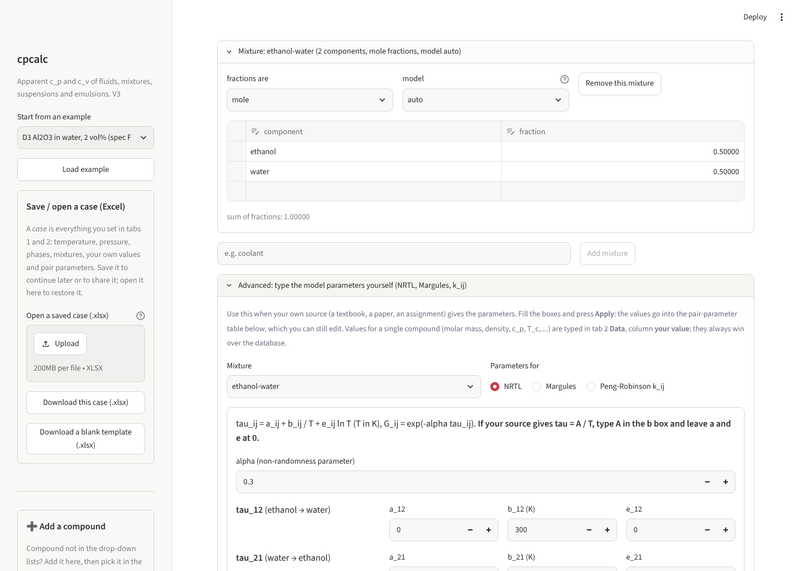

# CpCalc — Apparent Specific Heat Calculator

**Calculate the apparent specific heat capacities of pure substances, mixtures, and multiphase systems such as nanofluids, emulsions, and slurries.**

`cpcalc` estimates the specific heat capacity at constant pressure (cₚ) and constant volume (cᵥ) of a sample, showing the calculation procedure and thermodynamic reasoning behind every result.

Built with Python and Streamlit as part of the **CL 202 Topic 5 course project**.

**Live app:** _Add your Streamlit link here_



---

## Table of Contents

1. [What is this project about?](#what-is-this-project-about)
2. [Key concepts](#key-concepts)
3. [How CpCalc works](#how-cpcalc-works)
4. [Thermodynamic models](#thermodynamic-models)
5. [The application](#the-application)
6. [Command-line interface](#command-line-interface)
7. [Database](#database)
8. [Reliability and limitations](#reliability-and-limitations)
9. [Testing and validation](#testing-and-validation)
10. [Technologies and dependencies](#technologies-and-dependencies)
11. [Project structure](#project-structure)
12. [Version history](#version-history)

---

## 1. What is this project about?

**Specific heat capacity** tells us how much energy is required to raise the temperature of 1 kg of a material by 1 K. It is an important property in heating, cooling, and heat-exchanger calculations.

Finding the specific heat of a pure substance such as water is straightforward. Real samples, however, can be more complicated:

- A pure liquid, solid, or gas.
- A mixture, such as ethanol and water.
- Multiple phases together, such as solid particles suspended in a liquid (nanofluid or slurry), or droplets of one liquid dispersed in another (emulsion).

For these systems, a single tabulated value may not be sufficient. CpCalc calculates the apparent specific heat capacity using the properties of the individual phases.

**Given the temperature, pressure, and composition, CpCalc:**

1. Finds the cₚ of each phase using database values or a suitable thermodynamic model.
2. Calculates cᵥ using a thermodynamic identity.
3. Combines the phases to obtain the apparent cₚ and cᵥ of the complete sample.
4. Displays the procedure, equations, substituted values, results, assumptions, and reliability status.

The objective is not just to produce a number, but to make the thermodynamic reasoning behind it **transparent and traceable**.

---

## 2. Key concepts

| Term | Meaning |
|---|---|
| **cₚ** | Specific heat capacity at constant pressure. |
| **cᵥ** | Specific heat capacity at constant volume. |
| **Apparent specific heat** | Effective specific heat capacity of an entire mixture or multiphase sample, treated as one material. |
| **Phase** | A uniform part of a sample, such as a liquid, solid, or gas. |
| **Mass fraction (w)** | Mass of a phase divided by the total mass of the sample. |
| **αᵥ** | Volumetric thermal expansion coefficient. |
| **κₜ** | Isothermal compressibility. |
| **ρ** | Density. |

### Why are cₚ and cᵥ different?

At constant pressure, a heated material can expand and perform work on its surroundings. Therefore, additional energy is required.

At constant volume, expansion is restricted, so this additional work does not occur.

Consequently, cₚ is generally greater than or equal to cᵥ. The difference is significant for gases and relatively small for most liquids and solids.

---

## 3. How CpCalc works

### 3.1 Converting cₚ to cᵥ

The two specific heat capacities are related by the thermodynamic identity:

**cₚ − cᵥ = T αᵥ² / (ρ κₜ)**

Rearranging to calculate cᵥ:

**cᵥ = cₚ − T αᵥ² / (ρ κₜ)**

Where:

- T = absolute temperature (K)
- αᵥ = volumetric thermal expansion coefficient
- ρ = density
- κₜ = isothermal compressibility

These properties are obtained from the database, user-provided values, or the selected thermodynamic model.

### 3.2 Combining multiple phases

For cₚ, the individual phases are combined using a **mass-weighted average**:

**cₚ,app = Σᵢ wᵢ cₚ,ᵢ**

Here, wᵢ represents the mass fraction of phase i.

For cᵥ, a simple mass-weighted average is not used. Individual phases cannot independently remain at constant volume when the entire sample is held at constant volume.

Instead, the cᵥ of the complete sample is calculated using the thermodynamic identity above and the properties of the overall sample.

### 3.3 Calculation workflow

```text
             Define the sample
                (T, P, phases)
                      |
                      v
           Calculate cₚ of each phase
                      |
             +--------+--------+
             |        |        |
           Liquid   Solid     Gas
             |        |        |
            Data   Data/Debye  PR/Ideal gas
             |        |        |
             +--------+--------+
                      |
                      v
           Calculate cᵥ of phases
                      |
                      v
          Combine individual phases
                      |
                      v
              Apparent cₚ and cᵥ
                      |
                      v
             Results, assumptions,
               and reliability
```

---

## 4. Thermodynamic models

The thermodynamic models are implemented directly in the calculation engine rather than relying on separate thermodynamic-model libraries.

| Model | Application | Implementation |
|---|---|---|
| **Peng–Robinson Equation of State** | Gases and optionally liquids. Calculates cₚ, cᵥ, density, αᵥ, and κₜ using departure functions. | `pure.py` |
| **Debye Model** | Estimates the heat capacity of solids using the Debye temperature (θD). | `pure.py` |
| **Ideal Mixing** | Mass-weighted average of components, assuming no additional heat effect on mixing (cₚᴱ = 0). | `mixtures.py` |
| **Margules Model** | Binary liquid mixtures. Uses excess Gibbs energy with parameters A, B, and D to calculate excess enthalpy and excess heat capacity. | `mixtures.py` |
| **NRTL Model** | Binary liquid mixtures. Uses local-composition excess Gibbs energy with τ₁₂, τ₂₁, and α. Excess enthalpy and heat capacity are obtained through temperature differentiation. | `mixtures.py` |
| **Peng–Robinson Mixing Rules** | Gas mixtures using pure-component constants and binary interaction parameters (kᵢⱼ). | `mixtures.py` |

The **Theory** tab explains the equations, assumptions, applicability, and required inputs for each model.

### Why do mixtures need special models?

When two liquids are mixed, their resulting heat capacity is generally not just the weighted average of the individual components.

The difference is called the **excess heat capacity (cₚᴱ)**.

- Ideal mixing assumes cₚᴱ = 0.
- Margules and NRTL account for non-ideal mixing effects.

For example, ethanol and water exhibit significant non-ideal behaviour.

---

## 5. The application


The application contains five main tabs.

| Tab | Function |
|---|---|
| **1. System** | Set temperature and pressure, select cₚ, cᵥ, or both, and define phases, substances, amounts, and mixtures. Configure optional temperature, phase-amount, or composition sweeps. |
| **2. Data** | Inspect required properties, their sources, and availability. Override database values with custom inputs or provide temperature-dependent property curves. |
| **3. Results** | View apparent cₚ and cᵥ, phase-wise results, warnings, assumptions, calculation status, sweep charts, and downloadable reports. |
| **4. Calculation Sheet** | Follow the calculation route for each phase, including equations, substituted values, and intermediate results. |
| **5. Theory** | Explore 14 guided pages covering thermodynamic principles, models, equations, model selection, and symbols. |

### Additional features

- **Predefined examples:** 13 ready-to-run thermodynamic systems.
- **Excel case management:** Save and restore calculation setups using `.xlsx` workbooks.
- **Blank templates:** Generate Excel templates with predefined dropdown lists.
- **Custom compounds:** Add compounds manually or look them up using the `thermo` library.
- **Database browser:** Search the built-in database of 192 compounds.
- **Advanced model parameters:** Enter custom NRTL, Margules, and Peng–Robinson binary interaction parameters.

### Advanced mixture parameters

The Advanced section allows users to enter mixture-model parameters directly.

For example, consider an **ethanol (1) + water (2)** mixture using NRTL, with:

**τᵢⱼ = Aᵢⱼ / T**

| Parameter | Value |
|---|---:|
| A₁₂ (ethanol → water) | 3.17 K |
| A₂₁ (water → ethanol) | 523.84 K |
| α | 0.30 |
| All a and e parameters | 0 |

At 298.15 K, the application evaluates and displays τ, G, and the infinite-dilution activity coefficients as an input check:

**γ₁∞ = 5.86  γ₂∞ = 2.85**



### Quick start

Requirements: Python 3.10 or later.

Clone the repository:

```bash
git clone https://github.com/aarushloq/Specific-Heat-Calculator.git
cd Specific-Heat-Calculator
```

Create and activate a virtual environment:

**Windows:**

```bash
python -m venv venv
venv\Scripts\activate
```

**macOS / Linux:**

```bash
python -m venv venv
source venv/bin/activate
```

Install the dependencies and launch the application:

```bash
pip install -r requirements.txt
python -m cpcalc ui
```

The application opens at:

```text
http://localhost:8501
```

For detailed installation instructions and troubleshooting, see [SETUP.md](SETUP.md).

---

## 6. Command-line interface

The calculation engine can also be used without launching the web interface.

| Operation | Command |
|---|---|
| Launch the web interface | `python -m cpcalc ui` |
| List predefined examples | `python -m cpcalc examples` |
| Run one example with calculations | `python -m cpcalc example D3 --explain` |
| Run all examples | `python -m cpcalc example all` |
| Run a saved workbook | `python -m cpcalc run my_case.xlsx --explain --html sheet.html` |
| Generate an Excel template | `python -m cpcalc template --out my_case.xlsx` |
| Run the test suite | `python -m cpcalc test` |

An example can also be opened directly in the browser:

```text
http://localhost:8501/?example=D6
```

---

## 7. Database

The built-in database contains **192 compounds**, with temperature-dependent data wherever available.

It is generated using `tools/build_database.py`.

| Data category | Coverage |
|---|---|
| **CoolProp reference fluids** | About 130 fluids, including liquid cₚ, density, αᵥ, κₜ, ideal-gas cₚ, and critical properties. |
| **Additional liquids** | About 37 compounds from `thermo` / `chemicals` data methods, including alcohols, glycols, glycerol, acids, and solvents. |
| **Particle solids** | 24 solids, including oxides, metals, and SiC, with heat-capacity curves and selected density and thermodynamic properties. |
| **Specific reference values** | NIST-JANAF α-Al₂O₃ curve and θD(Cu) = 343 K (marked unverified). |

**Data sources:** CoolProp, NIST-JANAF, NIST WebBook, Zábranský, DIPPR/Perry, VDI, and CRC.

Every database record includes its source and evidence type.

> **Important:** Property data are never extrapolated beyond their supported temperature range. If a requested condition falls outside the available range, the calculation stops and reports the limitation.

---

## 8. Reliability and limitations

### Reliability levels

| Level | Meaning |
|---|---|
| **Experimental** | Evaluated property data from sources such as CoolProp reference equations, JANAF, Zábranský, DIPPR, and CRC. |
| **Estimated** | Values obtained using estimation methods. |
| **Illustrative** | Placeholder values intended only for demonstration. |

The reliability status of a calculation is determined by its **weakest input**.

Assumptions are reported explicitly and can lower the reliability status. Examples include:

- cₚᴱ = 0 for ideal mixtures.
- Vᴱ = 0 for mixture density.
- Assumed αᵥ and κₜ values.
- kᵢⱼ = 0 when binary interaction parameters are left blank.

### Model limitations

1. **Liquids:** Database data are used by default. Peng–Robinson is available when explicitly selected, since its liquid caloric errors can reach approximately 26%.
2. **Solids:** Database data are preferred, with the Debye model used as a fallback where appropriate.
3. **Gases:** Peng–Robinson is preferred, with the ideal-gas model available as a fallback.
4. **Pressure:** Liquid database values are based on 1 atm data. A warning is displayed above 6 bar.
5. **Mixtures:** NRTL and Margules support two components only. Gas mixtures can contain more components.
6. **NRTL parameters:** Parameters fitted to vapour–liquid equilibrium data may predict activity coefficients well but produce inaccurate heat-capacity corrections after temperature differentiation. Parameters fitted to excess enthalpy or excess heat-capacity data are preferable.

**Not currently included:**

- Measured excess volume and excess enthalpy represented as Redlich–Kister series.
- Pressure sweeps.
- Extrapolation of property data beyond supported ranges.

---

## 9. Testing and validation

The project includes automated tests covering the calculation engine, thermodynamic consistency, predefined examples, interface, workbook operations, and model validation.

Install the development dependencies:

```bash
pip install -r requirements-dev.txt
```

Run the test suite:

```bash
python -m cpcalc test
```

### Test coverage

| Test suite | Tests | Coverage |
|---|---:|---|
| Engine | 25 | Units, property lookup, ranges, fractions, mixture bases, errors, warnings, and status. |
| Consistency | 18 | Thermodynamic identities and limiting cases. |
| Examples | 25 | Predefined examples and specification targets for D1–D9. |
| Interface and I/O | 21 | Workbook operations, reports, CLI, database integrity, and web application. |
| V3 additions | 11 | NRTL check values, Theory equations, Advanced section, and save/open. |
| Validation | 32 | Comparison with CoolProp. Skipped if CoolProp is not installed. |

---

## 10. Technologies and dependencies

| Library | Purpose |
|---|---|
| **Python** | Core implementation |
| **NumPy** | Arrays and numerical computations |
| **SciPy** | Numerical integration for the Debye model |
| **Pandas** | Editable tables and data handling in the interface |
| **OpenPyXL** | Excel workbook import and export |
| **Streamlit** | Interactive web application |
| **thermo / chemicals** | External compound lookup |
| **pytest / sympy** | Development and testing |
| **CoolProp** | Database generation and validation |

The calculation engine itself (`cpcalc/engine.py` and its imported modules) requires only **NumPy and SciPy**.

---

## 11. Project structure

```text
Specific-Heat-Calculator/
│
├── streamlit_app.py
├── requirements.txt
├── requirements-dev.txt
├── README.md
├── SETUP.md
│
├── cpcalc/
│   ├── engine.py        # Main calculation engine
│   ├── pure.py          # Peng–Robinson, Debye, ideal gas
│   ├── mixtures.py      # Ideal, Margules, NRTL, PR mixing
│   ├── sample.py        # Sample and phase definitions
│   ├── properties.py    # Property retrieval
│   ├── database.py      # Database access
│   ├── lookup.py        # External compound lookup
│   ├── units.py         # Unit conversion
│   ├── workbook.py      # Excel import/export
│   ├── report.py        # Reports
│   ├── latex.py         # LaTeX calculation sheets
│   ├── theory.py        # Theory tab content
│   ├── examples.py      # Predefined examples
│   ├── app.py           # Streamlit interface
│   ├── cli.py           # Command-line interface
│   ├── constants.py
│   ├── errors.py
│   └── data/
│       └── database.json
│
├── docs/                # Screenshots
├── tests/
├── validate/
└── tools/
    └── build_database.py
```

---

## 12. Version history

### V3

- Added the Advanced section for entering NRTL, Margules, and Peng–Robinson kᵢⱼ parameters.
- Improved Excel save/open functionality and added a blank template.
- Reworked the Theory section into 14 guided pages, including a model chooser, symbol table, and separate pages for Margules, NRTL, and kᵢⱼ.
- Improved the README and setup documentation.
- Calculations unchanged, apart from the version number and an NRTL display helper.

### V2

- Introduced the Streamlit interface.
- Added the 192-compound database and custom compound support.
- Added LaTeX calculation sheets and Theory pages.
- Simplified the engine and workbook compared with V1.

### V1

- Initial calculation engine and Excel workbook following the course specification (Equations 1–23).

---

## Acknowledgements

Developed as a computational thermodynamics project for **CL 202**, focusing on estimating apparent specific heat capacities of fluids, mixtures, and multiphase systems.
